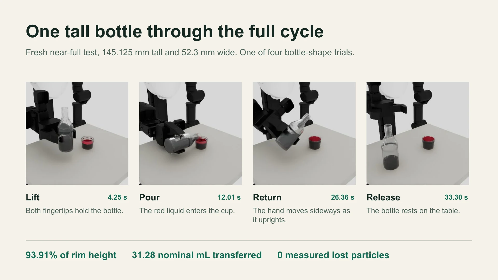

# Pour a drink. Know when to stop.

A robot must do more than tip a bottle. It must keep its grasp, recognize when the cup is full or the bottle is empty, and put the bottle back without spilling.

This project builds and evaluates that complete sequence for the **ROBOTIS FFW-BG2 in NVIDIA Isaac Sim**. It combines camera-based vessel estimates, supervised motion imitation, inverse kinematics and explicit stop-and-return logic.

[](https://vimeo.com/kadiru/demo-semihumanoid-pouring)

*A recorded simulation, not a physical-robot result. This example delivered 31.28 nominal mL with zero measured particle loss. [Trial evidence](evidence/bottle-size-A/autonomy-r0-test-results.json) · [Watch the development film](https://vimeo.com/kadiru/demo-semihumanoid-pouring). The film is an earlier development snapshot, not the revision 25 benchmark.*

<a name="what-passed-in-simulation"></a>

## What works today

**26 of 30 strict passes** in the November 24 revision 26 mixed-layout evaluation, following 29/30 on revision 25's placements. Normal 07 passed on its original and fresh placements. Across the new batch 28 attempts grasped, poured and returned the bottle, with zero particles spilled. Two attempts timed out before grasp, one empty stop lacked visual agreement, and one cup finished at 89.46% of rim height. [Revision 26 outcomes](evidence/bottle-size-A/wide-mixed-r26-completion.json) · [Revision 25 outcomes](evidence/bottle-size-A/wide-mixed-r25-completion.json)

A strict pass requires a confirmed grasp, liquid transfer, the intended stop, zero measured particle loss, and an ordered return and release. Near-full means at least 90% of rim height. These are particle-based simulation measurements with calibrated cameras and known vessel dimensions; physical transfer remains untested.

The distinction matters: the earlier **end-to-end behavior-cloning policy passed 0/6**. The stronger result belongs to the hybrid system described here. [Learning study](docs/LEARNING_A_STUDY.md) · [Full result history, including failures](docs/RESULTS_AND_REPRODUCTION.md#what-passed-in-simulation)

<a name="how-the-controller-works"></a>

## The central idea


Three cameras divide the task: locate the vessels, inspect the bottle, and estimate liquid level in the cup. The controller sends joint targets every 50 ms. An independent simulator audit measures contacts, liquid height and particle inventory so a visually convincing pour can still fail the test.

The project work spans the simulation testbed, perception and control integration, and trial-level evaluation. The robot platform and simulator are external dependencies; this is not a new robot design or a claim of end-to-end learned autonomy.

<a name="explore-the-repository"></a>

## Read the code

| Question | Entry point |
| --- | --- |
| How does a trial run? | [Simulation entry point](runtime/src/run_fountain.py) |
| How does it find and handle different vessels? | [Size-aware trial controller](runtime/src/pour_size_autonomy.py) · [Perception and autonomy guide](docs/SIZED_AUTONOMY.md) |
| How does the bottle return? | [Sideways return controller](runtime/src/pour_side_return.py) |
| What makes a result credible? | [Recording schema](docs/RECORDING_SCHEMA.md) · [Per-trial evidence](evidence/bottle-size-A/) |

<a name="try-the-offline-trial-logger"></a>

## Try the smallest example

With Python 3.9 or newer, from the repository root:

```sh
python3 tools/trial_log.py validate examples/synthetic-wet.json
```

This validates a **synthetic logger fixture**: 50 g delivered and 1 g spilled under its example protocol. It does not reproduce the strict simulator benchmark. [Logger guide](docs/TRIAL_LOG.md) · [Simulator setup and assets](runtime/README.md)

## Next milestone

Replay bottle confirmation in swapped 04 and normal 14, and investigate the two stop decisions in pair 09 before the next mixed-layout evaluation. Physical testing requires a separate calibrated setup and evaluation.

[Experiment history and reproduction](docs/RESULTS_AND_REPRODUCTION.md) · [Bottle-size study](docs/BOTTLE_SIZE_SESSION.md) · [Al-Jazari inspiration](docs/HISTORY.md) · [Current work log](STATUS.md)
