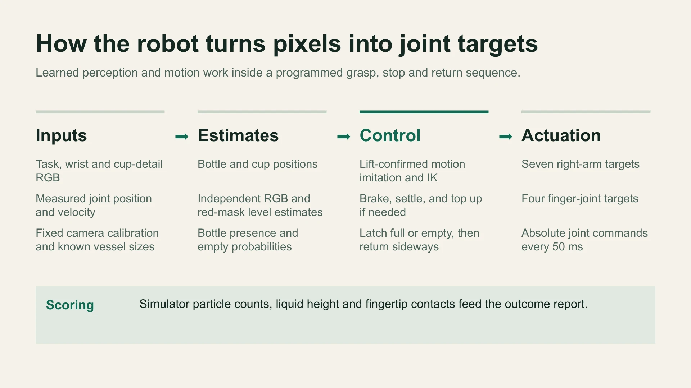

# How the ROBOTIS AI Worker pours a drink

A stationary ROBOTIS FFW-BG2 uses its right arm to pick up a bottle, pour into a cup, and place the bottle back on the table in NVIDIA Isaac Sim. The controller must recognize two different endings from camera images. A nearly full cup calls for a stop even when liquid remains in the bottle. An empty bottle calls for a stop even when the cup is below the fill target.


This tall, narrow bottle delivered 31.28 nominal mL. The liquid settled at 93.91% of the cup’s rim height with zero measured particle loss. [Four bottle-shape trial records](evidence/bottle-size-A/autonomy-r0-test-results.json)

## How the controller works

The arm receives joint targets every 50 ms. Three camera views share the work. The task view locates the vessels, the wrist view checks the bottle, and a close-up of the cup tracks its outline and liquid level. The experiments use calibrated cameras and known vessel dimensions.



Supervised motion imitation and inverse kinematics generate the pouring motion. Programmed logic checks the grasp, brakes and settles the pour, then controls the return. The simulator independently records fingertip contacts, liquid height and particle inventory to score the result. [Cup perception and control](docs/SIZED_AUTONOMY.md) · [Sideways return implementation](runtime/src/pour_side_return.py)

## What passed in simulation?

A strict pass requires a verified grasp, liquid transfer, the intended stop, zero measured particle loss, and an ordered return and release. The near-full target starts at 90% of rim height. Each row below identifies its own evaluation conditions.

| Evaluation | Strict passes | What happened |
| --- | ---: | --- |
| [End-to-end behavior cloning](docs/LEARNING_A_STUDY.md) | 0/6 | The policy grasped the bottle in five tests. None transferred liquid. |
| [Sideways return with standard vessels](docs/SIDE_RETURN_STUDY.md) | 28/30 | Two empty-target pours each lost two particles. |
| [Four bottle shapes, near-full target](evidence/bottle-size-A/autonomy-r0-completion.json) | 4/4 | One cup, two bottle heights and two diameters. Each shape passed one fresh trial. |
| [Same four shapes, empty target](evidence/bottle-size-A/empty-r0-completion.json) | 4/4 | Each bottle stopped with zero source particles and zero measured spill. |
| [Mixed layouts, revision 11](evidence/bottle-size-A/wide-mixed-r11-completion.json) | 29/30 | One particle escaped during coarse pouring. |
| [Mixed layouts, revision 12, Nov. 17, 2026](evidence/bottle-size-A/wide-mixed-r12-completion.json) | 26/30 | All 30 completed the grasp, intended stop and return. All 15 near-full trials passed. Four empty-target trials each lost two particles. |
| [Mixed layouts, revision 13b, Nov. 17, 2026](evidence/bottle-size-A/wide-mixed-r13b-completion.json) | 28/30 | All four prior spill layouts passed fresh. All 30 grasped, reached the intended stop and returned. Normal 00 lost two particles and normal 01 lost four. |
| [Mixed layouts, revision 14, Nov. 18, 2026](evidence/bottle-size-A/wide-mixed-r14-completion.json) | 27/30 | Both targeted layouts passed fresh. Across the batch, 28/30 were spill-free. Two trials lost two particles each, and one spill-free trial stopped with its fill unconfirmed. |
| [Mixed layouts, revision 15, Nov. 18, 2026](evidence/bottle-size-A/wide-mixed-r15-completion.json) | 29/30 | All 29 completed pours were spill-free, including all 15 swapped layouts. Normal 02 stopped before grasp when the cup could not be localized. |
| [Mixed layouts, revision 16, Nov. 19, 2026](evidence/bottle-size-A/wide-mixed-r16-completion.json) | 26/30 | All 30 localized both vessels and normal 02 passed. Of 29 actual pours, 26 were spill-free. One attempt stopped at grasp confirmation. |
| [Mixed layouts, revision 17, Nov. 19, 2026](evidence/bottle-size-A/wide-mixed-r17-completion.json) | 29/30 | All 30 grasped, poured, stopped as intended and returned. All four repaired layouts passed. Swapped 02 lost two particles during coarse pouring. |

The revision 12 change repaired the spill seen in revision 11. Fresh testing exposed spills in other layouts. Physical-robot transfer remains untested. [Bottle-size experiments and failure analysis](docs/BOTTLE_SIZE_SESSION.md) · [Dated experiment log](STATUS.md)

## Explore the repository

| If you want to… | Start here |
| --- | --- |
| Trace a trial from simulation to control | [Simulator entry point](runtime/src/run_fountain.py), [size-aware perception and trial runner](runtime/src/pour_size_autonomy.py), [return controller](runtime/src/pour_side_return.py) |
| Understand how the method evolved | [First learned policy](docs/LEARNING_A_STUDY.md), [wider layouts](docs/WORKSPACE_STUDY.md), [cup-size autonomy](docs/SIZED_AUTONOMY.md), [bottle-size and mixed-layout studies](docs/BOTTLE_SIZE_SESSION.md) |
| Inspect the measurements | [Trial-level reports and audit files](evidence/bottle-size-A), [measurement and recording schema](docs/RECORDING_SCHEMA.md) |
| Set up the simulator or inspect the earlier teleoperation setup | [Runtime profiles and prerequisites](runtime/README.md), [Quest runbook](docs/QUEST_RESTORE.md), [external robot assets, weights and recordings](docs/VERSION_CONTROL.md) |
| Follow the historical inspiration | [Al-Jazari’s drink-serving automata](docs/HISTORY.md) |

## Try the offline trial logger

From the repository root, validate the bundled synthetic example with Python 3.9 or newer. The command prints 50 g delivered, 1 g spilled and a passing result under the logger’s example protocol. The simulator benchmark above uses separate particle-based scoring.

```sh
python3 tools/trial_log.py validate examples/synthetic-wet.json
```

[Logger commands and record format](docs/TRIAL_LOG.md) · [Synthetic example](examples/synthetic-wet.json) · [Logger source](tools/trial_log.py)
