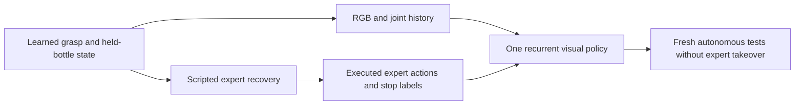

# Automatic expert recovery and corrective learning

Completed November 2–3, 2026, in native Isaac Sim on the guarded RTX 4070. **The automatic scripted takeover works. The learned policy still fails the complete zero-spill task.** No Quest teleoperation was required.

## What was implemented

`pour_recovery.py` takes over after eight simulated seconds only if the bottle has a verified physical grasp, both fingers are currently contacting it and it remains lifted. It registers the measured tool-to-bottle transform, plans an aligned bottle mouth pose above the cup, and commands ordinary joint drives to pour, stop, return upright, set down and open the fingers. The bottle remains dynamic, with gravity and no attachment constraints. The expert never writes bottle or particle poses. Its stop controller uses exact simulator volumes and a short flow/runoff estimate. Those privileged values are training supervision only.

Eight native attempts produced **four complete zero-spill recoveries**: three training episodes and one independent validation episode. Four learner prefixes missed grasp and were retained but excluded. Every expert intervention that actually started completed successfully. Training recoveries cover both stopping conditions: 28/5 and 35/0 nominal mL bottle/cup starts emptied the source; 98/0 stopped at 67.907808 mL in the cup (93.28% nominal brim), retaining 30.09312 mL in the bottle. Independent 92/5 validation ended at 66.321504 mL in the cup. Both camera views were manually reviewed for all four admitted recoveries.

[Empty-bottle recovery video](../evidence/recovery-A/first-empty-recovery.mp4), [near-full recovery video](../evidence/recovery-A/near-full-recovery.mp4). Their control labels explicitly distinguish the learned prefix from the scripted intervention. These are training demonstrations, not autonomous task successes.

## How the data teaches the policy

Hybrid HDF5 schema v4 stores `expert_supervision=1` only for actual expert-issued commands. The learner's preceding images/joints provide recurrent history, and its actions are excluded from the loss. Future labels beyond recording ends or outside supervised frames are masked. This prevents teaching the policy to reproduce its stalled prefix. Camera observations and labels have matched timestamps; simulator poses, particle counts and stop labels remain outside policy observations.

The admitted dataset contains **28 training episodes / 6,941 observation transitions / 6,464 supervised actions**: 19 original full references, six corrective grasp prefixes and three new recoveries. **Five validation episodes / 1,540 observations / 1,381 supervised actions** retain their independent role. The new recoveries contribute 602 supervised training transitions after their unlabeled histories. Material A, both RGB cameras and the accepted 1.8 mm / 400 Hz fluid settings remain fixed.

V6 is **full-sequence supervised behavior cloning**: two RGB encoders + a 192-unit GRU, 337,240 parameters, 20 Hz control and ten-step absolute action chunks with temporal ensembling. Inputs are only task/wrist RGB and measured joint positions/velocities. One policy generates arm and gripper commands, with auxiliary phase, fill, stop and completion heads. There is no reinforcement learning, privileged-state action fallback or expert takeover during autonomous tests. The fit ran 1,800 updates in 60.94 seconds excluding loading; validation selected update 900.

V6 validation produced one grasp/pour/near-full decision out of two cases. That case reached 65.650824 nominal mL in the cup but spilled 1.708776 mL and never opened its fingers, so it was not complete. A bounded V7 experiment fitted only 2,150 gripper parameters for 600 updates, weighting recorded release phases 12×. Independent checkpoint comparison confirmed every other tensor stayed bitwise identical. Native validation regressed (33.189912 mL spill in the near-full case and a missed second grasp), so V7 was rejected. Both models and failures are retained. **V6 was selected using validation alone before the six fresh tests; no model changes occurred during those tests.**

[Final model](../evidence/recovery-A/best-bc-v6.pt), [provenance](../evidence/recovery-A/model-summary-final.json), [selection record](../evidence/recovery-A/model-selection.json), [V7 validation](../evidence/recovery-A/recovery-results-bc-v7.json). The selected SHA256 is `31eb87ec353c51259b2da79c49a743fe436ee08daa0dbfe6b68cfebd333caeb2`. Root `best.pt` matches it; `last.pt` belongs to the rejected head experiment and is not the tested policy.

## Six fresh autonomous outcomes

**3/6 verified initial grasps; 3/6 transferred at least 1 nominal mL into the cup; 0/6 completed autonomously; 0/6 completed the zero-spill task.** All six pre-fit frozen cases ran, with no expert fallback. Final outside-volume mean was 16.495812 nominal mL; maximum was 31.755240 mL. Zero outside volume in a missed-grasp/no-pour case is not a successful task.

| Case | Bottle / cup initially, nominal mL | Grasp verified | Delivered to cup, nominal mL | Final outside vessels, nominal mL | Full zero-spill task |
| --- | ---: | :---: | ---: | ---: | :---: |
| test_00 | 26 / 4 | No | 0.000 | 22.319 | No |
| test_01 | 94 / 10 | Yes | 60.070 | 3.260 | No |
| test_02 | 38 / 6 | Yes | 12.364 | 25.637 | No |
| test_03 | 88 / 12 | No | 0.000 | 0.000 | No |
| test_04 | 20 / 9 | No | 0.000 | 16.003 | No |
| test_05 | 99 / 3 | Yes | 67.243 | 31.755 | No |

Two cases filled the cup above 90% but did not reliably finish the return/release sequence. The short-source case incorrectly called “cup near full” with only about 25% cup inventory, then lost the remaining liquid. Stop predictions could latch while later motion cycled through earlier phases. A stop-class prediction therefore does not establish successful physical stopping. Three cases missed grasp. The prior V5 suite used different cases; these counts are not a matched comparative trial.

[Complete JSON](../evidence/recovery-A/final-benchmark.json), [CSV](../evidence/recovery-A/final-benchmark.csv), [actual autonomous test video](../evidence/recovery-A/autonomous-test01.mp4). The video includes its measured spill and continues through the failed completion; it is not a scripted recovery.

Success definitions retain verified sustained grasp, the policy's own completion signal, upright set-down, zero final outside particles and zero below-worktop crossings, with either cup inventory ≥90% nominal brim or source residual ≤max(0.25 mL, 1% initial source). Strict scoring additionally retains the declared stop-label gates. Completion uses the predicted stop latch, open fingers and low joint velocity for 0.5 s; that check supplies no actions or fluid-state stop input. Eight-second grasp and 32-second overall horizons terminate failed attempts. Volumes are spacing-cubed nominal particle volume (quantum 0.005832 mL), not physical millilitre calibration. The below-worktop measurement is a geometric proxy, not a contact-force measurement.

## Evidence and operation

All **18 new complete recordings** passed camera/timestamp/action integrity checks, and every local HDF5 matches its native SHA256. [Backup index](../data/material-A-recovery/backup-index.json), [integrity report](../evidence/recovery-A/recording-integrity.json). One aborted initial probe inherited an unrelated 1 mm/1 kHz viewer preset; it was caught before takeover, excluded, and its partial file/old plan are retained. All completed study scenes use the accepted physics. The original V5 plan/model/test data remain unchanged.

Only the project-owned container was restarted. Final container `6eeb7b9965526b7dc60d60b1a5ceb58fdf135eca7629e0bb93b32838b51830af` exposes only the RTX 4070, retains the immutable-ID priority guard, four-core quota on CPUs16–23, nice10, shares256 and 16 GiB RAM/no extra swap. No humanoid or sibling jobs were changed. The lab is idle for inspection, with no queued trials, active recording or training. [Final runtime verification](../evidence/recovery-A/runtime-final.json), [live lab](http://192.168.68.60:8212/).

Remote project `/home/kadir/aiworker-pouring-4070`; study `learning/A-recovery-20261102-v1/`; native runs `20261103T065336Z` (recovery collection/V6 validation) and `20261103T073425Z` (V7 validation/final V6 tests). Frozen scene plan SHA is `1411c293eb1754e2000106ae6b2060b162f050c9454cc68cdfa78b1050b32555`. Test placements/fills use seed20261107 and were frozen before fitting.

To regenerate: on Ubuntu run `docker exec -w /workspace/src aiworker_pouring_4070 nice -n 10 /isaac-sim/python.sh recovery_report.py --require-six`; copy the study JSON/model files locally, then run `python3 projects/aiworker-pouring/tools/summarize_recovery_benchmark.py` from the Mac workspace. The report enforces the exact six frozen names, accepted physics and no expert fallback. Twelve relevant deployed/local source hashes match, including the unchanged actor and the selected full-sequence trainer.

The remaining learning work is reliable visual full/empty detection and coordination of the predicted stop with return, set-down and release. A subsequent experiment should explicitly condition motion on the policy's own latched stop mode and collect corrections at these observed post-stop failure states. These six cases are now used evaluation evidence; any next candidate needs fresh reserved seeds.
